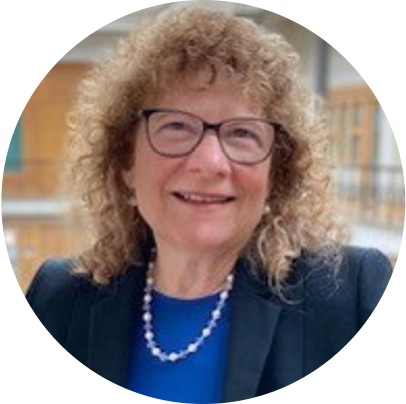
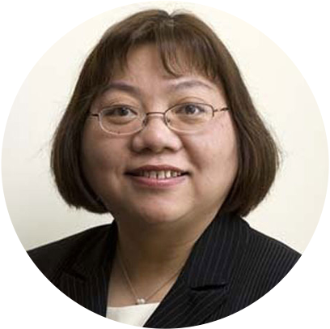
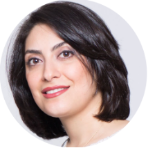
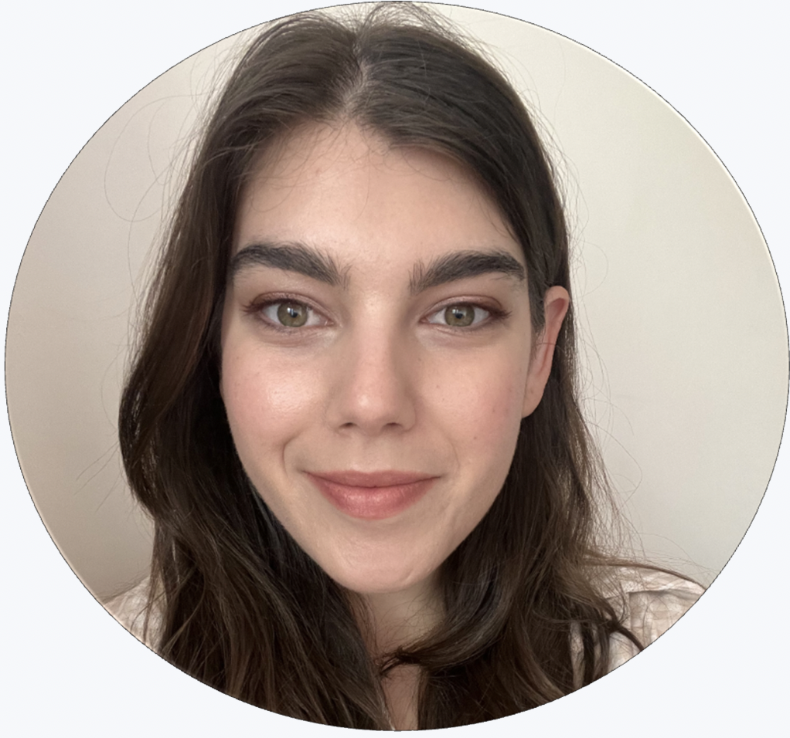
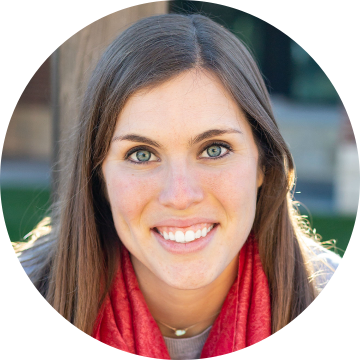
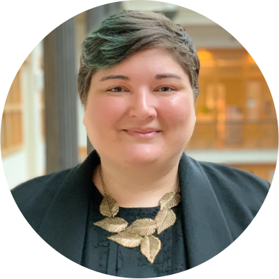

###  <b>DSCPE Team Leaders</b>

<table>
  <tr><td rowspan="1" width="25%;float:left;margin:10px"></td>
    <td>
<b>Elaine Martin</b>  RDMLA/DSCPE Co-Leader | Director of Collaborative Initiatives  Countway Library of Medicine, Harvard Medical School
</td></tr>
  <tr><td rowspan="1" width="width:100px;float:left;margin:10px"></td>
    <td>
<b>Rong Tang</b>  RDMLA/DSCPE Co-Leader | Professor Emerita   School of Library and Information Science, Simmons University
</td></tr>
</table>
  
 

  
###  <b>DSCPE Past Team</b>
  <table>
  <tr><td rowspan="1" width="width:100px;float:left;margin:10px"></td>
    <td>
<b>Shabnam Shahvar</b>  Project Research Assistant | Technology Coordinator  Countway Library of Medicine, Harvard Medical School.  January 2023 - November 2026
</td></tr>

   <tr><td rowspan="1" width="25%;float:left;margin:10px"></td>
    <td>
<b>Samantha Friedman</b>  Project Coordinator   Countway Library of Medicine, Harvard Medical School.  December 2024 - November 2026
</td></tr>
    
  <tr><td rowspan="1" width="25%;float:left;margin:10px"></td>
    <td>
<b>Perry Weidling</b>
</td></tr>
 <tr><td rowspan="1" width="25%;float:left;margin:10px"></td>
    <td>
<b>Ashley Thomas</b>
</td></tr>   
 </table>

